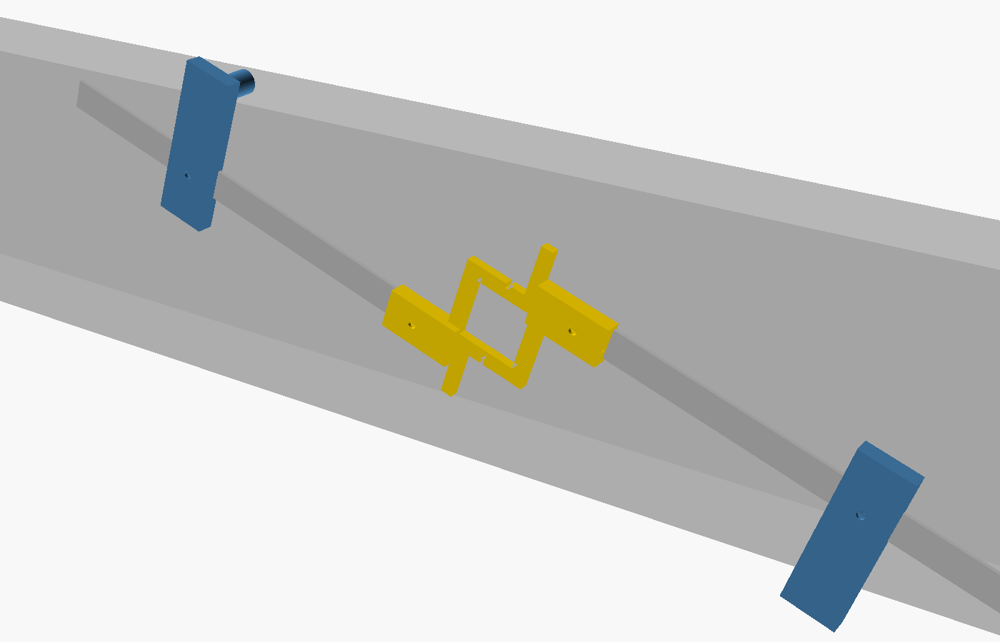

# Scarf joint jig

Adjustable marking jig for a keyed scarf joint (stop-splayed scarf with a pair of folding wedges, *trait de Jupiter*) cut through the beam's depth. It works for any beam from ~10 cm deep (6x12 and up). The butts and the wedge window sit at 90 degrees to the splay.

## Parts

- `exports/frame.stl`: the wedge-window frame. It holds both rails. 1x.
- `exports/block.stl`: the sliding block, with a round contact pin. 2x (the same file twice).
- `*-mirrored.stl`: a mirrored set, for marking the back face of the beam.
- 2 aluminium flat bars, 1" x 1/8" (25.4 x 3.2 mm), cut to the length the model prints in its echo (~400 mm).
- 4 x M4 x 16 countersunk screws and 4 M4 nuts, to fix the bars to the frame. Countersink the bars and drill them using the frame as a guide.
- 2 x M6 x 50 wing screws and 2 M6 nuts, to lock the blocks.

Print flat, no supports. The frame prints upside down.

## Use

1. **Caliper.** Hold the jig across the beam. Close each block on the beam's depth, between the block face and the frame's fin, then lock it. The splay is now H.
2. **Lay it on the beam face.** Put the window centre on the support axis, then rotate the jig until one pin touches the top of the beam and the other touches the bottom. The splay angle sets itself for that beam.
3. **Mark.** The bar edges give the splays (a notch in the frame lets the pencil follow the line in). The block faces give the butts. Trace inside the window for the wedges. Repeat on the other piece. Use the mirrored set on the back face.

## Parameters

- `kw` is the window side, which is also the combined wedge thickness.
- `modo` is how the pin height `pv` is solved, exact at `H_ref`:
  - `X=kw` (default): butt = window side, so the window lines up with the cut.
  - `angulo fixo`: the angle does not change with the window.
  - `X fixo`: fixed butt length.
- `H`, `teste_H` and `parte` drive the preview: beam depth, a test bar of length H in the caliper jaws, and which part to show.

Comments in the `.scad` are in Portuguese. The jig was made for the garage roof beams (8x25 and 8x35).
